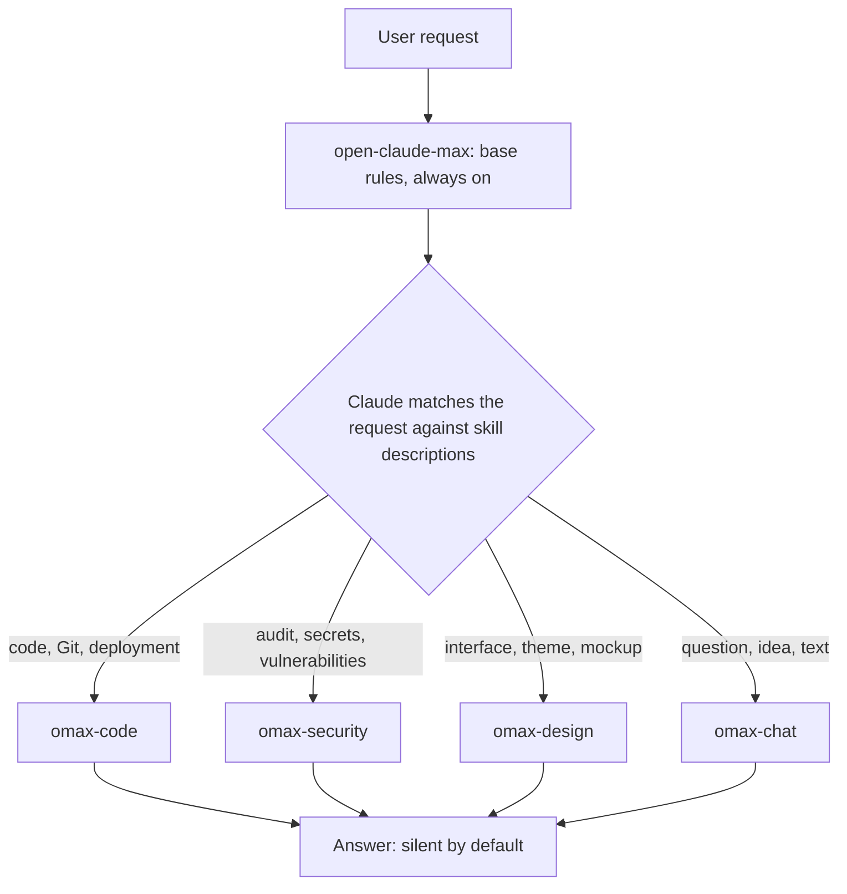

# Architecture

This document describes the structure of the pack and how a request goes through it. It is meant for whoever picks the project up later.

## Principle

The repository only contains text: instructions for Claude. No executable code, no dependency, no network access. It changes neither the model, nor the plans, nor the usage limits.

There are no modes and no slash commands. Claude loads each skill by reading its `description`. The skill text itself is written in French.

## Layout

```text
open-claude-max/
├── README.md                          # Presentation, install, usage, limits (English)
├── ARCHITECTURE.md                    # This document
├── CHANGELOG.md                       # Version history
├── LICENSE                            # MIT
├── .gitignore
├── .github/workflows/ci.yml           # Checks every skill has valid front matter
└── skills/
    ├── open-claude-max/SKILL.md       # Base rules, apply to everything
    ├── omax-code/SKILL.md             # Code, Git, deployment
    ├── omax-security/SKILL.md         # Defensive security audit
    ├── omax-design/SKILL.md           # Interfaces and themes
    └── omax-chat/SKILL.md             # Questions, ideas, writing
```

## Flow of a request



A request can match several skills at once. The base rules always apply.

## Roles

| Skill | Owns | Does not own |
|---|---|---|
| `open-claude-max` | Language, silent output, honesty, attribution, readability | Anything specific to code, design, security or chat |
| `omax-code` | Work loop, commits, PRs, refactoring, migrations, scaffolds, deployment | Security audits, visual design |
| `omax-security` | Audit order and report format | Fixing code (that goes through `omax-code`) |
| `omax-design` | Art direction, palette, states, themes, render check | Backend logic |
| `omax-chat` | Answer length, brainstorming, comparisons, writing, fact-checking | Code and interface work |

## Adding or changing a skill

1. Create `skills/<name>/SKILL.md`. The folder name must equal the `name` field.
2. Write a `description` that says what the skill does and when to use it. This is what triggers it, so be specific.
3. Keep the body short and precise. Rules that always apply go in `open-claude-max`, not in each skill.
4. Add the skill to the table in `README.md` and in the diagram above.
5. Add an entry under `[Unreleased]` in `CHANGELOG.md`.
6. Check that CI passes.

## Design constraints

- **No magic**: no rule asks Claude to access something it does not have.
- **No bypass**: no rule targets a usage limit or a plan.
- **Defensive security only**: `omax-security` never produces offensive code.
- **Readable**: a developer who did not follow the discussion must understand every file.
