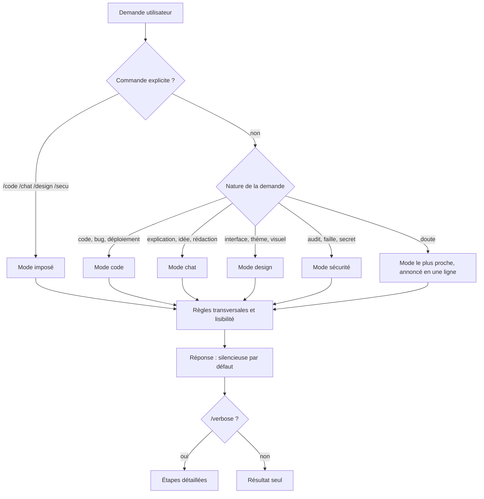

# Architecture

Ce document décrit la structure du skill et la façon dont une demande le traverse. Il sert de repère à qui reprend le projet.

## Principe

Le projet ne contient que du texte : des instructions pour Claude. Il n'y a ni code exécutable, ni dépendance, ni accès réseau. Il ne change ni le modèle, ni les plans, ni les limites d'usage.

## Arborescence

```text
open-claude-max/
├── SKILL.md                  # Instructions principales, lues par Claude
├── README.md                 # Présentation, installation, exemples
├── ARCHITECTURE.md           # Ce document
├── CHANGELOG.md              # Historique des versions
├── LICENSE                   # Licence MIT
├── .gitignore
├── docs/
│   ├── code.md               # Guide détaillé du mode /code
│   ├── chat.md               # Guide détaillé du mode /chat
│   ├── design.md             # Guide détaillé du mode /design
│   └── securite.md           # Guide détaillé du mode /secu
└── .github/workflows/
    └── ci.yml                # Vérifie l'arborescence et le front matter
```

## Rôle des fichiers

| Fichier | Rôle | Qui le lit |
|---|---|---|
| `SKILL.md` | Règles courtes et précises, chargées avec le skill | Claude |
| `docs/*.md` | Détails, exemples, commandes. Chargés à la demande | Claude et développeurs |
| `README.md` | Entrée du dépôt : installation, usage, limites | Humains |
| `ARCHITECTURE.md` | Structure et flux | Développeurs |
| `CHANGELOG.md` | Versions et changements | Développeurs, utilisateurs |
| `ci.yml` | Contrôle automatique à chaque push | GitHub Actions |

Règle de séparation : `SKILL.md` reste court. Tout ce qui dépasse quelques lignes par mode va dans `docs/`.

## Flux d'une demande



## Ordre de lecture pour Claude

1. `SKILL.md` : choix du mode, règles transversales, lisibilité, règles de chaque mode.
2. `docs/<mode>.md` : seulement si la tâche demande le détail (checklist de déploiement, format de rapport, etc.).

## Ajouter un mode ou une règle

1. Ajoute la règle courte dans `SKILL.md`, dans la section du mode concerné.
2. Mets le détail dans `docs/<mode>.md`.
3. Si le mode est nouveau : ajoute la commande au tableau « Choisir le mode » et au schéma ci-dessus.
4. Ajoute une entrée dans `CHANGELOG.md` sous `[Unreleased]`.
5. Vérifie que la CI passe.

## Contraintes de conception

- **Pas de magie** : aucune règle ne demande au modèle d'accéder à quoi que ce soit qu'il n'a pas.
- **Pas de contournement** : aucune règle ne vise une limite d'usage ou un plan.
- **Français par défaut** : les noms de commandes et de fichiers restent en anglais ou en minuscules.
- **Audit défensif uniquement** : le mode sécurité ne produit aucun code offensif.
- **Relisible** : un développeur qui n'a pas suivi la discussion doit comprendre chaque fichier.
