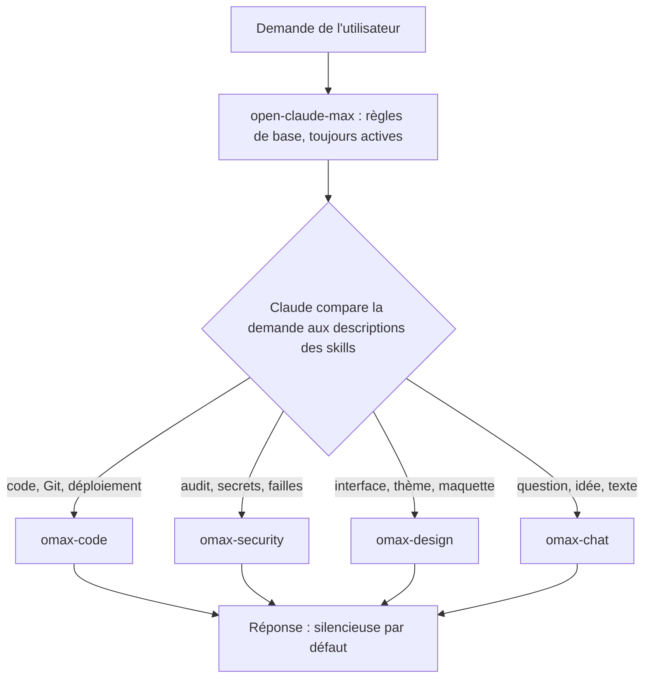
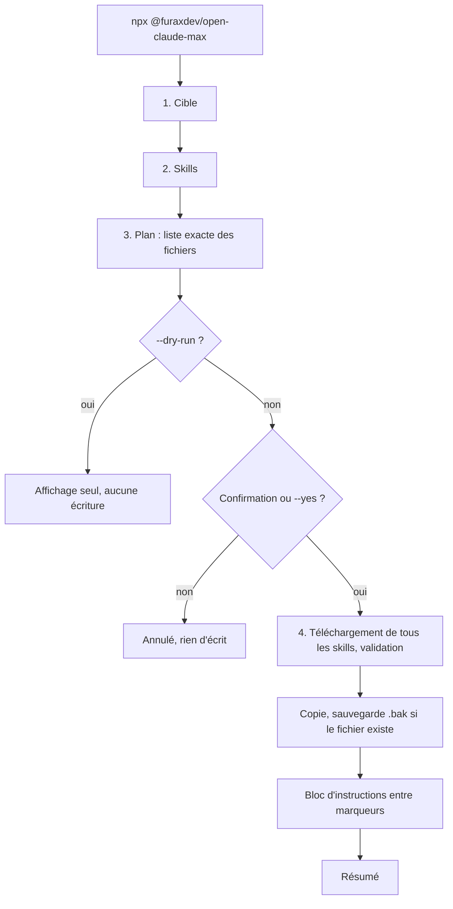

# Architecture

Ce document décrit la structure du dépôt, le chemin d'une demande et le fonctionnement du CLI. Il sert de repère à qui reprend le projet.

## Principe

Le dépôt contient deux choses :

- des **skills** : des fichiers texte d'instructions pour Claude, qui ne changent ni le modèle, ni les plans, ni les limites d'usage ;
- un **CLI** Node, sans dépendance, qui copie ces fichiers au bon endroit pour l'outil choisi.

Il n'y a ni mode ni commande slash. Claude charge chaque skill d'après sa `description`.

## Arborescence

```text
open-claude-max/
├── README.md                       # Présentation, installation, limites
├── ARCHITECTURE.md                 # Ce document
├── CHANGELOG.md                    # Historique des versions
├── LICENSE                         # MIT
├── package.json                    # Paquet npm @furaxdev/open-claude-max
├── bin/open-claude-max.js          # Point d'entrée du binaire
├── src/
│   ├── cli.js                      # Assistant : questions, plan, confirmation, exécution
│   ├── targets.js                  # Chemins par outil (Claude Code, Codex, OpenCode)
│   ├── skills.js                   # Liste des skills, téléchargement, validation
│   ├── files.js                    # Plan, copie, sauvegardes .bak, désinstallation
│   ├── block.js                    # Bloc d'instructions entre marqueurs
│   └── ui.js                       # Couleurs, spinner, lecture des réponses
├── skills/
│   ├── open-claude-max/SKILL.md    # Règles de base, toujours actives
│   ├── omax-code/SKILL.md
│   ├── omax-security/SKILL.md
│   ├── omax-design/SKILL.md
│   └── omax-chat/SKILL.md
├── docs/install-sans-cli.md        # Message à coller pour les agents sans CLI
├── test/                           # Tests node:test
└── .github/workflows/ci.yml
```

## Flux d'une demande (les skills)



Une demande peut déclencher plusieurs skills. Les règles de base s'appliquent toujours.

## Flux du CLI



Règles du CLI :

- **Rien n'est écrit avant la confirmation.** Une entrée terminée sans réponse équivaut à un refus.
- **Tout est téléchargé et validé avant la première écriture.** Un échec réseau ne laisse aucun fichier à moitié copié.
- **Réseau limité** à `raw.githubusercontent.com/furaxdev/open-claude-max`, sans redirection. Les fichiers sont du texte, jamais exécuté.
- **Sauvegarde** : un fichier existant et différent est copié en `.bak` (puis `.bak.1`, etc.) avant d'être remplacé ou modifié. Un fichier identique n'est pas touché.
- **Marqueurs** `<!-- open-claude-max:start -->` et `<!-- open-claude-max:end -->` : le bloc est remplacé, jamais dupliqué. Des marqueurs incohérents arrêtent le CLI sans rien modifier.
- **Désinstallation** : retire les `SKILL.md` dont le front matter porte le bon nom, puis le bloc si plus aucun skill du pack n'est installé. Les `.bak` restent.

## Chemins par cible

Les chemins sont dans `src/targets.js`, avec leur source (documentation officielle de l'outil). Ce que la documentation ne précise pas (`CLAUDE_CONFIG_DIR`, `CODEX_HOME` pour les skills, `XDG_CONFIG_HOME`) n'est pas deviné : le CLI affiche une note quand la variable est définie. Voir la section « Ce qui est certain » du README.

## Ajouter ou modifier un skill

1. Crée `skills/<nom>/SKILL.md`. Le dossier porte le même nom que le champ `name`.
2. Écris une `description` en français qui dit ce que fait le skill et quand l'utiliser, avec les mots que l'utilisateur emploie. Pas de `: ` ni de ` #` dans la valeur (YAML).
3. Ajoute le skill à la liste de `src/skills.js` (avec sa phrase de déclenchement).
4. Régénère le message de `docs/install-sans-cli.md` : le test vérifie que son bloc est identique à celui du CLI.
5. Mets à jour le tableau du README et `CHANGELOG.md`, puis lance `npm test`.

## Contraintes de conception

- **Pas de magie** : aucune règle ne demande à Claude d'accéder à ce qu'il n'a pas.
- **Pas de contournement** : rien ne vise une limite d'usage ou un plan.
- **Sécurité défensive uniquement** : `omax-security` ne produit aucun code offensif.
- **Aucune dépendance** dans le CLI : Node 18 ou plus suffit.
- **Relisible** : un développeur qui n'a pas suivi la discussion doit comprendre chaque fichier.
